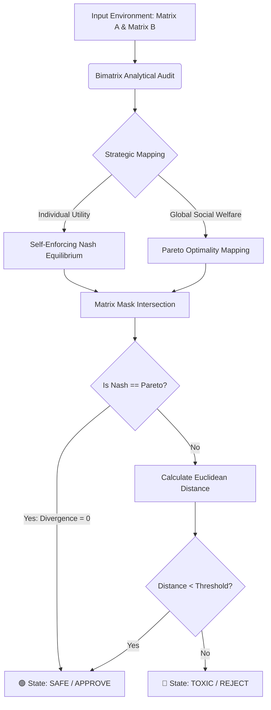
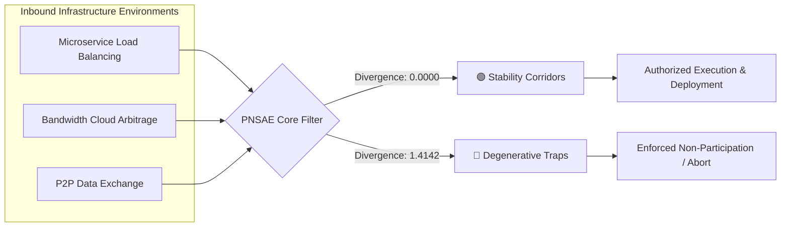

# Pareto-Nash Stability Arbitrage Engine (PNSAE)

**Pareto-Nash Stability Arbitrage Engine** is a high-performance, JAX-compatible analytical framework designed to audit, filter, and police decentralized infrastructures, multi-agent networks, and game-theoretic micro-environments.


```
## 🧠 Core Philosophy & Strategy

The engine implements a proactive approach known as **Stability Arbitrage (Enforcement of Rational Altruism)**. Instead of participating blindly in chaotic or adversarial environments, an agent utilizes this engine to audit the structural matrix of an interaction *before* allocating resources. 

The framework mathematically bifurcates environments into two explicit classes:

*   **🟢 Stability Corridors (Zones of Rational Altruism):** Systems where individual, decentralized egoism (Nash Equilibrium) structurally converges with global efficiency and maximum social welfare (Pareto Optimality). In these environments, destructive or predatory behavior is naturally penalized by the geometry of the payoff matrix itself. No centralized policing is required.
*   **🔴 Toxic / Degenerative Environments:** Systems (such as the classic Prisoner's Dilemma or cyclic zero-sum games like Rock-Paper-Scissors) where individual gradients inevitably drag agents toward mutually destructive traps (e.g., mutual betrayal or infinite resource expenditure), despite the existence of a globally superior cooperative state. The engine flags these systems as high-risk and enforces immediate non-participation.

---
---
## 🛠️ Architecture and Engineering Features

*   **Bimatrix Analytical Solver:** Built on raw matrix masks (`jnp.max`) to completely bypass gradient play flaws, saddle points, and local minima entrapment during optimization.
*   **Zero Computational Noise:** Features a deterministic grid-search logic that delivers 100% reproducible results.
*   **Scalability & JAX Foundation:** Fully compatible with Google's `JAX` ecosystem, preparing the code for massive matrix dimensions and parallel execution on hardware accelerators (GPU/TPU).

---
---
## 💻 Code Architecture (`engine.py`)




---

The core analytical pipeline is encapsulated into a production-ready, clean Python class:

```python
import jax.numpy as jnp
from typing import Dict, Any

class StabilityArbitrageEngine:
    def __init__(self, threshold: float = 0.5):
        self.threshold = threshold

    def _kl_divergence(self, p: jnp.ndarray, q: jnp.ndarray) -> float:
        p_clipped = jnp.clip(p, 1e-7, 1.0)
        q_clipped = jnp.clip(q, 1e-7, 1.0)
        return float(jnp.sum(p_clipped * jnp.log(p_clipped / q_clipped)))

    def analyze_system(self, matrix_A: jnp.ndarray, matrix_B: jnp.ndarray) -> Dict[str, Any]:
        n, m = matrix_A.shape
        
        # 1. Self-Enforcing Nash Equilibrium Mapping (Egoism)
        best_for_p1 = (matrix_A == jnp.max(matrix_A, axis=0, keepdims=True))
        best_for_p2 = (matrix_B == jnp.max(matrix_B, axis=1, keepdims=True))
        nash_mask = best_for_p1 & best_for_p2
        nash_indices = jnp.argwhere(nash_mask)
        
        # 2. Global Social Welfare Pareto Mapping (Altruism)
        total_welfare = matrix_A + matrix_B
        max_welfare = jnp.max(total_welfare)
        pareto_mask = (total_welfare == max_welfare)
        
        # 3. Intersection Check (Convergence of Interests)
        overlap_mask = nash_mask & pareto_mask
        has_perfect_balance = bool(jnp.any(overlap_mask))
        
        # 4. Divergence Metrics and Operational State Allocation
        if has_perfect_balance:
            distance = 0.0
            best_cell = jnp.argwhere(overlap_mask)
            row, col = best_cell, best_cell
        else:
            nash_float = nash_mask.astype(float)
            pareto_float = pareto_mask.astype(float)
            distance = float(jnp.sqrt(jnp.sum((nash_float - pareto_float) ** 2)))
            
            if len(nash_indices) > 0:
                row, col = nash_indices, nash_indices
            else:
                row, col = 0, 0
                
        x = jnp.zeros(n).at[row].set(1.0)
        y = jnp.zeros(m).at[col].set(1.0)
        is_safe = has_perfect_balance or (distance < self.threshold)
        
        return {
            "is_safe": is_safe,
            "divergence": distance,
            "strategy_p1": x,
            "strategy_p2": y,
            "has_perfect_balance": has_perfect_balance
        }
```

---

## 🖥️ Production Real-World Benchmarks




The system was evaluated against three realistic, domain-neutral engineering infrastructures included in the pipeline execution block:

### 1. Server Load Balancing (Coaligned Interests)
Independent microservices dynamically allocate incoming traffic between available pipelines `[Channel_1, Channel_2, Backup]`. If they segregate into different channels, network throughput spikes (+8). If a collision occurs, latency drops to zero.
*   **Engine Analysis:** Divergence = **`0.0000`** -> **🟢 APPROVED**.
*   **Result:** Nodes autonomously converge to ` / `, perfectly matching the Pareto social optimum with Nash stability.

### 2. Bandwidth Scarcity Arbitrage (Rigid Zero-Sum Game)
Two enterprise cloud tenants compete for a fixed 10 Gbps channel. Every megabit grabbed by Tenant 1 is a direct infrastructure loss for Tenant 2.
*   **Engine Analysis:** Divergence = **`0.0000`** -> **🟢 APPROVED**.
*   **Result:** The algorithm maps a stable "balance of power" equilibrium point ` / ` where both nodes operate at full capacity, capping malicious over-saturation risks.

### 3. P2P Data Exchange Protocol (Free-Riding Risks)
Nodes choose whether to share high-speed data fragments `[Seed, Partial Seed, Leech]`. Mutual seeding yields a fast network (+5), but individual incentives strictly prioritize purely leeching to save outbound bandwidth (+8).
*   **Engine Analysis:** Divergence = **`1.4142`** -> **🔴 REJECTED**.
*   **Result:** Individual эгоистичные gradients pull bots into a devastating mutual leeching sink ` / `, killing network vitality. The engine flags the protocol as toxic and aborts execution.

---

## 🚀 Installation & Verification

1. Clone the repository:
```bash
git clone https://github.com
cd paret-nash-stability-arbitrage-engine
```
2. Run the integrated test suite:
```bash
python engine.py
```

## 📝 License
This project is licensed under the MIT License - see the LICENSE file for details.

